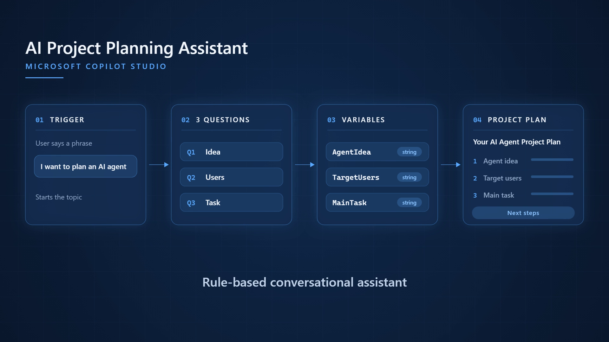
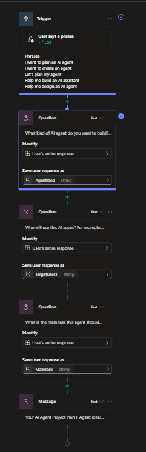
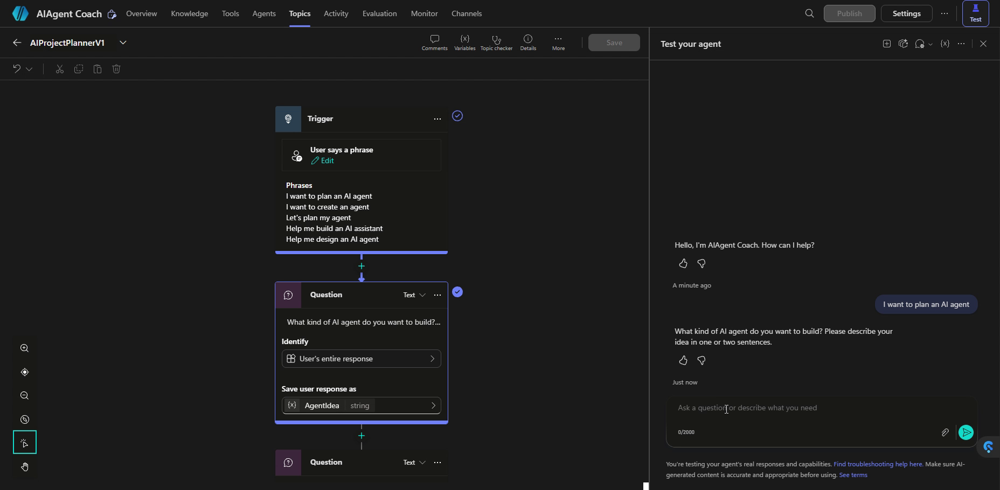
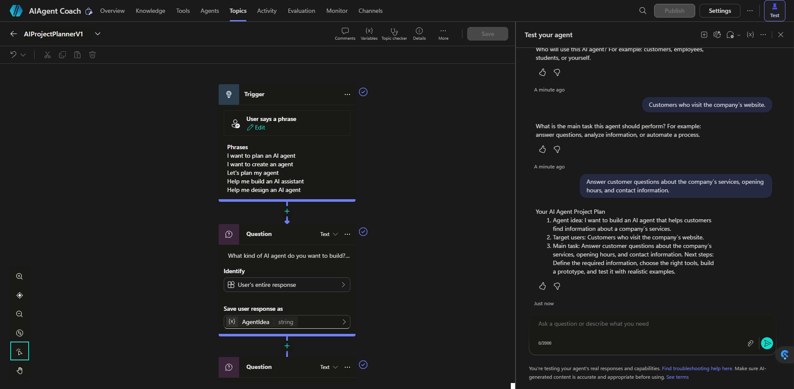

# AI Project Planning Assistant — Microsoft Copilot Studio learning project

**Rule-based · Tested in the Copilot Studio test chat · Not published · No generative AI**

[English](#english) · [Svenska](#svenska) · [Back to Portfolio](https://portfolio-site-9d14e9-34d94a51044ee8e3a.webflow.io/)

---

# English

## Summary

A small conversational learning prototype built and tested in Microsoft Copilot Studio. It asks three questions about an idea for an AI agent and shows a simple project plan built from the answers.

It is an additional Microsoft learning project. It is not one of the three main portfolio case studies (Lead Capture Automation, Order Handoff Automation, AI Research Agent).

## At a glance

| | |
|---|---|
| Project type | Additional Microsoft learning project |
| Platform | Microsoft Copilot Studio |
| Agent | AIAgent Coach (Standard) |
| Active topic | `AIProjectPlannerV1` |
| Kind of assistant | **Rule-based**: a fixed topic with a trigger, three questions, three variables and one final message |
| Generative AI in the assistant | **None** |
| Tested | In the Copilot Studio test chat, first on 2026-10-28. The screen recording behind the images and the demo video was made on 2026-10-29. |
| The Copilot Studio agent | **Not published.** Only tested in the test chat, by me. |
| Environment | School Microsoft environment |
| Demo video | [Swedish demonstration on YouTube](https://youtu.be/HW64UX39Pn0) (unlisted, about 60 seconds) |

## Published portfolio vs. unpublished agent

These are two different things:

- **The portfolio website is published.** It shows a short card about this project with the demo video.
- **The Copilot Studio agent is not published.** No real users, no channel, no deployment. The video being on YouTube does not change that.

## What it is, and what it is not

- It **is** a rule-based assistant. Every step is written in advance.
- It is **not** a generative or autonomous AI agent. It does not generate answers, use a knowledge source, call other systems or decide anything on its own.
- The plan it shows is a **fixed template filled with the user's three saved answers.**
- Generative AI features, credits and licensing were limited in the school Microsoft environment I used, so I built the part that worked there.

## How it works

1. **Trigger.** The topic starts when the user writes one of five phrases:
   - I want to plan an AI agent
   - I want to create an agent
   - Let's plan my agent
   - Help me build an AI assistant
   - Help me design an AI agent
2. **Question 1** — answer saved in `AgentIdea`:
   > What kind of AI agent do you want to build? Please describe your idea in one or two sentences.
3. **Question 2** — answer saved in `TargetUsers`:
   > Who will use this AI agent? For example: customers, employees, students, or yourself.
4. **Question 3** — answer saved in `MainTask`:
   > What is the main task this agent should perform? For example: answer questions, analyze information, or automate a process.
5. **Final message**, titled "Your AI Agent Project Plan". It shows the three answers through the variables, then ends with the same general next steps for every user: define the required information, choose the right tools, build a prototype, and test it with realistic examples.

In all three question nodes, **Identify** is set to *User's entire response* and the variable type is *string*. Each answer is saved exactly as typed, as free text.

***Illustrative diagram — not a screenshot and not evidence.** It was drawn for the demo video to show the flow. "Idea / Users / Task" are short names for the three questions, not their exact text. The real Copilot Studio screens are in the Evidence section below.*

## Evidence

Three images from the real Copilot Studio authoring screen and test chat. These are the evidence for this project.

**1. The topic canvas** (screenshot taken by me). Shows the trigger with its five phrases, the three question nodes with *Identify: User's entire response* and the variables `AgentIdea`, `TargetUsers` and `MainTask` (string), and the final message node.

**2. The start phrase and Question 1** (still from my own screen recording of the test chat, 2026-10-29, not edited). The phrase "I want to plan an AI agent" starts the topic and the first question appears. The `AgentIdea` question node is highlighted on the canvas.

**3. The final plan** (still from the same recording, not edited). After the three answers, the message "Your AI Agent Project Plan" shows the three answers and the general next steps.

## Demo video

[Watch the Swedish demonstration on YouTube](https://youtu.be/HW64UX39Pn0) — about 60 seconds, unlisted (only people with the link can watch).

- It shows a short animation of the flow, then the real test conversation in Copilot Studio, from the trigger phrase to the final plan.
- Long pauses while typing were cut out, so the video is shorter than the real test.
- **The Swedish narration is AI-generated in Microsoft Clipchamp (voice: Sofie). It is not my own voice.**

## Testing

I tested in the Copilot Studio test chat. The topic recognises the start phrase, asks the three questions in order, and shows a filled-in plan with the three answers (see the evidence above). Tested by me only, with my own test conversations.

## Limitations

- Fixed flow only. It does not handle free conversation outside the trigger phrases.
- The next steps in the final message are general. They are the same for every user and are not based on the answers.
- No generative AI answers, no knowledge source, no connection to other tools, no flow or automation behind it.
- Answers are saved as free text, exactly as typed.
- Not published and not used by real users.

## Possible next steps (not implemented)

- Generative answers or a knowledge source, if a licence and credits become available.
- Next steps that depend on the user's answers.
- Publishing to a test channel.

## What I learned

I learned how a Copilot Studio topic is put together: a trigger with example phrases, question nodes that save the user's answer in a variable, and a message that uses those variables. I also learned that trigger phrases in two different topics can conflict with each other, and that this needs to be checked while testing. Building it showed me the difference between a rule-based assistant, which only follows what I write for it, and a generative agent, which this project is not.

## Project transparency

- This is a **learning prototype** built and tested in a school Microsoft environment. It was not built for a client and does not include measured results.
- The **assistant is rule-based and has no generative AI.** The **agent is not published.**
- The **portfolio website is published**; it links to the demo video. That is separate from the agent.
- The **Swedish voice in the demo video is AI-generated** in Microsoft Clipchamp (Sofie).
- Images 1–3 are real Copilot Studio screens: image 1 is a screenshot, images 2 and 3 are unedited stills from my own screen recording. The flow diagram is an illustration, not evidence.

## Files

- `README.md` — this document
- `assets/02-topic-canvas.png` — topic canvas screenshot (evidence 1)
- `assets/01-test-chat-trigger-and-question-1.png` — test chat still (evidence 2)
- `assets/03-test-chat-final-plan.png` — test chat still (evidence 3)
- `assets/04-flow-schematic.png` — illustrative flow diagram (not evidence)
- Demo video: [YouTube](https://youtu.be/HW64UX39Pn0) (not stored in this repository)

---

# Svenska

## Sammanfattning

En liten konversationsprototyp för lärande som jag byggde och testade i Microsoft Copilot Studio. Den ställer tre frågor om en idé för en AI-agent och visar en enkel projektplan utifrån svaren.

Det är ett extra Microsoft-lärprojekt. Det är inte en av de tre stora fallstudierna i portfolion (Lead Capture Automation, Order Handoff Automation, AI Research Agent).

## I korthet

| | |
|---|---|
| Projekttyp | Extra Microsoft-lärprojekt |
| Plattform | Microsoft Copilot Studio |
| Agent | AIAgent Coach (Standard) |
| Aktivt ämne | `AIProjectPlannerV1` |
| Typ av assistent | **Regelbaserad**: ett fast ämne med en utlösare, tre frågor, tre variabler och ett avslutande meddelande |
| Generativ AI i assistenten | **Ingen** |
| Testad | I testchatten i Copilot Studio, först 2026-10-28. Skärminspelningen bakom bilderna och demovideon gjordes 2026-10-29. |
| Copilot Studio-agenten | **Inte publicerad.** Bara testad i testchatten, av mig. |
| Miljö | Skolans Microsoft-miljö |
| Demovideo | [Svensk demonstration på YouTube](https://youtu.be/HW64UX39Pn0) (olistad, cirka 60 sekunder) |

## Publicerad portfolio, opublicerad agent

Det här är två olika saker:

- **Portfoliowebbplatsen är publicerad.** Den visar ett kort om projektet med demovideon.
- **Copilot Studio-agenten är inte publicerad.** Inga riktiga användare, ingen kanal, ingen driftsättning. Att videon ligger på YouTube ändrar inte det.

## Vad den är, och vad den inte är

- Den **är** en regelbaserad assistent. Varje steg är skrivet i förväg.
- Den är **inte** en generativ eller autonom AI-agent. Den genererar inga egna svar, använder ingen kunskapskälla, anropar inga andra system och bestämmer ingenting själv.
- Planen den visar är en **fast mall som fylls i med användarens tre sparade svar.**
- Generativa AI-funktioner, krediter och licenser var begränsade i skolans Microsoft-miljö, så jag byggde den del som fungerade där.

## Så fungerar den

1. **Utlösare.** Ämnet startar när användaren skriver en av fem fraser:
   - I want to plan an AI agent
   - I want to create an agent
   - Let's plan my agent
   - Help me build an AI assistant
   - Help me design an AI agent
2. **Fråga 1** — svaret sparas i `AgentIdea`. Den frågar vilken typ av AI-agent användaren vill bygga.
3. **Fråga 2** — svaret sparas i `TargetUsers`. Den frågar vem som ska använda agenten.
4. **Fråga 3** — svaret sparas i `MainTask`. Den frågar vilken huvuduppgift agenten ska ha.
5. **Avslutande meddelande** med rubriken "Your AI Agent Project Plan". Det visar de tre svaren via variablerna och slutar med samma allmänna nästa steg för alla: definiera den information som behövs, välj rätt verktyg, bygg en prototyp och testa den med realistiska exempel.

Frågorna och meddelandet i assistenten är på engelska. I alla tre frågor är **Identify** inställt på *User's entire response* och variabeltypen är *string*. Varje svar sparas precis som det skrevs, som fri text.

***Illustrativt diagram — inte en skärmbild och inte bevis.** Det ritades till demovideon för att visa flödet. "Idea / Users / Task" är korta namn på de tre frågorna, inte frågornas exakta text. De riktiga Copilot Studio-skärmarna finns under Bevis nedan.*

## Bevis

Tre bilder från den riktiga Copilot Studio-skärmen och testchatten. Det är det här som är beviset för projektet.

**1. Ämnets canvas** (skärmbild som jag tog). Visar utlösaren med fem fraser, de tre frågenoderna med *Identify: User's entire response* och variablerna `AgentIdea`, `TargetUsers` och `MainTask` (string), samt det avslutande meddelandet.

**2. Startfrasen och fråga 1** (stillbild från min egen skärminspelning av testchatten, 2026-10-29, inte redigerad). Frasen "I want to plan an AI agent" startar ämnet och den första frågan visas. Frågenoden för `AgentIdea` är markerad på canvas.

**3. Den avslutande planen** (stillbild från samma inspelning, inte redigerad). Efter de tre svaren visar meddelandet "Your AI Agent Project Plan" svaren och de allmänna nästa stegen.

## Demovideo

[Se den svenska demonstrationen på YouTube](https://youtu.be/HW64UX39Pn0) — cirka 60 sekunder, olistad (bara de som har länken kan se den).

- Den visar en kort animation av flödet och sedan det riktiga testsamtalet i Copilot Studio, från utlösarfrasen till den avslutande planen.
- Långa pauser vid skrivandet är klippta, så videon är kortare än det verkliga testet.
- **Den svenska berättarrösten är AI-genererad i Microsoft Clipchamp (rösten Sofie). Det är inte min egen röst.**

## Testning

Jag testade i testchatten i Copilot Studio. Ämnet känner igen startfrasen, ställer de tre frågorna i ordning och visar en ifylld plan med de tre svaren (se beviset ovan). Testad bara av mig, med egna testsamtal.

## Begränsningar

- Bara ett fast flöde. Den hanterar inte fri konversation utanför utlösarfraserna.
- De nästa stegen i det avslutande meddelandet är allmänna. De är lika för alla och bygger inte på svaren.
- Inga generativa AI-svar, ingen kunskapskälla, ingen koppling till andra verktyg, inget flöde eller någon automatisering bakom.
- Svaren sparas som fri text, precis som de skrevs.
- Inte publicerad och inte använd av riktiga användare.

## Möjliga nästa steg (inte genomförda)

- Generativa svar eller en kunskapskälla, om licens och krediter finns.
- Nästa steg som beror på användarens svar.
- Publicering till en testkanal.

## Vad jag lärde mig

Jag lärde mig hur ett ämne i Copilot Studio är uppbyggt: en utlösare med exempelfraser, frågenoder som sparar användarens svar i en variabel och ett meddelande som använder variablerna. Jag lärde mig också att utlösarfraser i två olika ämnen kan komma i konflikt med varandra, och att det behöver kontrolleras vid testning. Bygget visade mig skillnaden mellan en regelbaserad assistent, som bara följer det jag skriver åt den, och en generativ agent, vilket det här projektet inte är.

## Projektets transparens

- Det här är en **prototyp för lärande** som byggdes och testades i en skolas Microsoft-miljö. Den byggdes inte åt en kund och innehåller inga uppmätta resultat.
- **Assistenten är regelbaserad och har ingen generativ AI.** **Agenten är inte publicerad.**
- **Portfoliowebbplatsen är publicerad** och länkar till demovideon. Det är något annat än agenten.
- **Den svenska rösten i demovideon är AI-genererad** i Microsoft Clipchamp (Sofie).
- Bild 1–3 är riktiga Copilot Studio-skärmar: bild 1 är en skärmbild, bild 2 och 3 är oredigerade stillbilder från min egen skärminspelning. Flödesdiagrammet är en illustration, inte bevis.

## Filer

- `README.md` — det här dokumentet
- `assets/02-topic-canvas.png` — skärmbild av ämnets canvas (bevis 1)
- `assets/01-test-chat-trigger-and-question-1.png` — stillbild från testchatten (bevis 2)
- `assets/03-test-chat-final-plan.png` — stillbild från testchatten (bevis 3)
- `assets/04-flow-schematic.png` — illustrativt flödesdiagram (inte bevis)
- Demovideo: [YouTube](https://youtu.be/HW64UX39Pn0) (lagras inte i det här repot)
